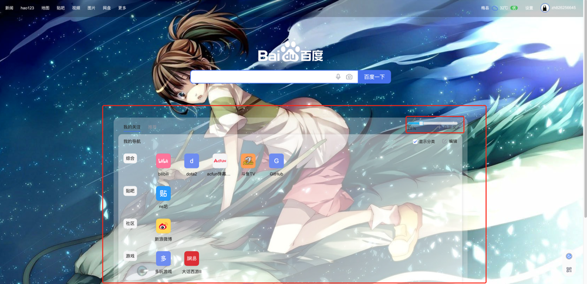
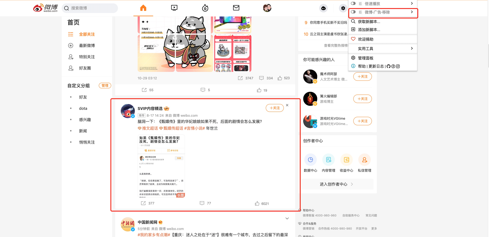
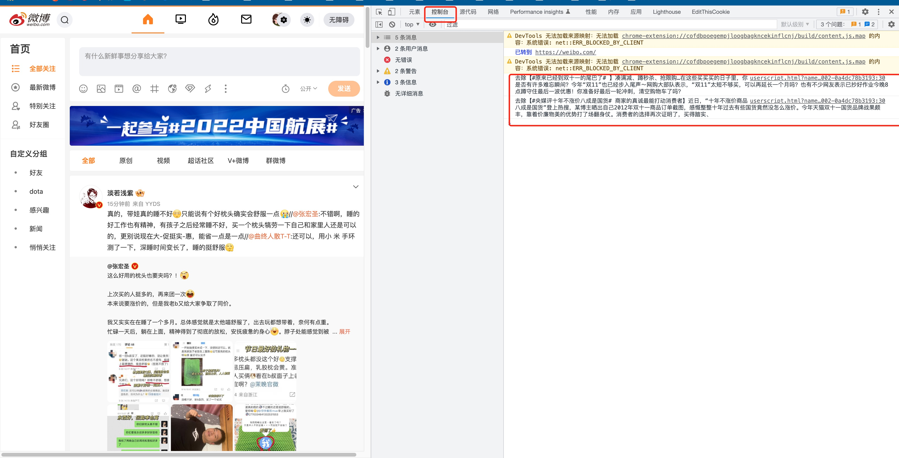

# 我的油猴脚本库

## 1. 给百度页面增加透明效果
自定义的百度本来是可以调节透明度的，后来不知道什么原因去掉了这个功能，只能自己来动手了

首页卡片右上角默认只显示背景不透明度百分比，鼠标移入或键盘聚焦后展开“背景”滑块（0% 完全透明，100% 不透明），文字保持清晰。设置会自动保存，支持新版热搜卡片、键盘方向键调节及卡片动态加载。
### 脚本
[change_baidu_navigation_bar.js](./change_baidu_navigation_bar.js)
### 效果

## 2. 手机页面自动跳转到 PC 页面
一些网站的手机页面不会自动跳转到 PC 版页面，造成 PC 访问体验很差

目前适配的网站
- 京东商品详情页
- 虎扑帖子页面
- 微博详情页
### 脚本
[app_url_to_pc.js](./app_url_to_pc.js)
## 3. 去除微博广告
浏览器刷微博时经常夹杂广告推送，并且内容质量很差，直接去除
### 脚本
[remove_weibo_advertising.js](./remove_weibo_advertising.js)
### 效果

## 4. 下载文件名和复制名称保持一致
给无损音乐下载站点增加下载文件名修正，点击弹窗中的“点击下载”时，实际保存文件名和“复制名称”一致。
### 脚本
[music_download_filename_sync.js](./music_download_filename_sync.js)

## 5. 替换 Gemini 网页的字体以区分大写 I 和小写 l
由于 Gemini 网页默认字体难以区分大写字母 `I` 和小写字母 `l`，本脚本将对话消息、提问和输入框字体替换为更易辨识的 Verdana 字体，同时保持代码块的等宽字体并确保系统图标正常显示。
### 脚本
[gemini_font_replacer.js](./gemini_font_replacer.js)

## 6. Medium 免费阅读跳转
在 Medium 页面右下角增加“免费阅读”按钮，点击后跳转到对应的 Freedium 镜像页面。
### 脚本
[medium_free_link.js](./medium_free_link.js)

## 7. 腾讯频道监控上报死循环修复
广告拦截器阻断腾讯频道的 Aegis 遥测上报后，监控 SDK 会把“上报失败”再次上报，造成每秒数千次请求和 CPU 占用飙升。本脚本拦截该遥测请求并直接返回成功响应，避免死循环。
### 脚本
[qq_channel_aegis_report_loop_fix.js](./qq_channel_aegis_report_loop_fix.js)

## 8. 隐藏 X 的“为你推荐”
隐藏 X 首页顶部的“为你推荐”标签，并在页面默认选中推荐流时自动切换到“正在关注”。
### 脚本
[x_hide_for_you_tab.js](./x_hide_for_you_tab.js)
